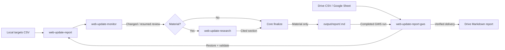

# wsum

Local-first Agent Skills for monitoring public web pages, PDFs, and feeds, researching meaningful changes, and producing cited Markdown reports. **Python handles fetching and durable state; the AI agent handles materiality decisions and research.** Google Workspace delivery is optional.

## Choose an entrypoint

| Goal | Invoke | Required skills |
| --- | --- | --- |
| Monitor targets with the core API | [`web-update-monitor`](skills/web-update-monitor/SKILL.md) | Monitor |
| Create reports in a local workspace | [`web-update-report`](skills/web-update-report/SKILL.md) | Report, monitor, research |
| Restore state and deliver reports via Google Drive | [`web-update-report-gws`](skills/web-update-report-gws/SKILL.md) | All four |

[`web-update-research`](skills/web-update-research/SKILL.md) is a child skill used **only for material changes**, not a standalone monitoring entrypoint. Install each required skill separately from the [packaging workflow](https://github.com/dceoy/wsum/actions/workflows/agent-skills-package.yml?query=branch%3Amain), or use this checkout's `.agents/skills/` discovery links (`.claude/skills/` points to them). Invoke only the chosen entrypoint.

## Quick start

### Local reporting

Use Python 3.11+ and a host agent with Skill discovery and shell execution. From a checkout:

```bash
git clone https://github.com/dceoy/wsum.git
cd wsum
uv sync --no-dev
source .venv/bin/activate
```

Create a targets CSV (see below), then invoke the skill in the local agent:

```text
/web-update-report
Targets: /absolute/path/to/targets.csv
Workspace: /absolute/path/to/workspace
```

The CSV and workspace are separate paths. The skill validates input, creates a missing workspace root safely, resumes pending reviews, and writes reports under `output/report/`. **The first successful check establishes baselines; it does not produce a change report.** Subsequent material changes can produce one report per check run. No Google tools are required.

Optionally supply either `Common context:` (inline text) or `Context source: /path/to/context.md`, not both.

### Google Workspace reporting (optional)

Install all four skills and invoke:

```text
/web-update-report-gws
Targets: <LOCAL_CSV_OR_DRIVE_CSV_OR_GOOGLE_SHEET>
Output: <EXISTING_DEDICATED_DRIVE_FOLDER>
```

The wrapper restores verified snapshots, validates the current target table, invokes the local workflow, checkpoints core operations, and delivers **completed** Markdown reports through Drive. Optional context can be inline or an explicit Google Doc/Drive Markdown `Context source:`; local Markdown paths are **not** supported by this wrapper.

See the [GWS Skill](skills/web-update-report-gws/SKILL.md) and [Claude Code Routines runbook](docs/claude-code-routines.md) for folder binding, Base64 transport, exact-byte verification, recovery, and limits. **Live Cowork/Routines connector round trips remain unverified**; offline connector tests are not an operational guarantee.

## How it works



A new URL establishes its baseline without research. Each subsequent changed URL has one pending review; repeated CSV interests for the same URL share a fetch. The monitor persists candidate evidence and recovery state, while the agent evaluates current criteria and newly linked documents. Material updates receive research; non-material changes advance the baseline without a report. The GWS wrapper persists each core transition and withholds delivery while reviews remain pending.

## Targets and workspace

Provide a UTF-8 CSV. Only `name` and `url` are required; optional columns are `publisher`, `category`, `keywords`, `criteria`, `priority`, and `enabled`. For example:

```csv
name,url,criteria,enabled
API updates,https://example.com/releases,Report breaking API changes,true
Pricing updates,https://example.com/releases,Report pricing changes,true
```

These are **placeholder URLs**, not live monitoring targets. Replace them before running. Repeated exact URLs share one fetch, and changes are material if they match any enabled interest. See the [CSV contract](skills/web-update-monitor/SKILL.md#workspace) for validation and traversal limits.

Local state is separate from the targets CSV:

```text
workspace/
├── output/report/             # canonical run-level Markdown reports
└── internal/
    ├── state/snapshots/        # accepted baselines
    ├── state/pending/          # resumable reviews
    ├── state/recovery/         # interrupted transactions
    └── evidence/               # optional captured source evidence
```

Only `output/` is user-facing. Do not edit `internal/` by hand. The GWS wrapper additionally stores input projection and delivery metadata under `internal/gws/` and verified snapshots in Drive.

## Core CLI (optional)

For debugging or manual orchestration, the monitor provides a deterministic CLI. Its workspace root must already exist:

```bash
mkdir -p /path/to/workspace
python skills/web-update-monitor/scripts/workspace.py \
  --workspace /path/to/workspace --targets /path/to/targets.csv check --compact
```

`check` alone does **not** perform an AI materiality review or finalize reports. Use `web-update-report` for end-to-end local reporting. See [monitor commands](skills/web-update-monitor/SKILL.md#interface) for `pending`, `finalize`, `ingest`, and recovery behavior.

## Development

```bash
uv sync
uv run pytest
```

[CI](.github/workflows/ci.yml) runs tests, linting, security checks, and validation of all four canonical Agent Skills with [`skills-ref`](https://github.com/agentskills/agentskills/tree/main/skills-ref).

Keep operational targets CSVs, downloaded content, `output/`, `internal/`, and credentials out of Git. Browser-rendered sources require separately controlled public-network egress; static-fetch failures must not silently trigger a browser.
