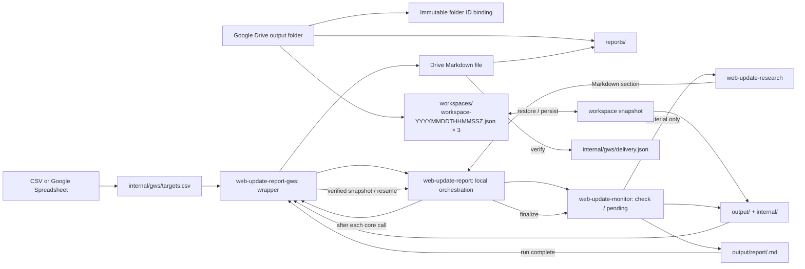
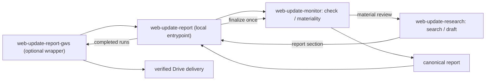

# wsum

Local-first Agent Skills for detecting meaningful updates on public websites and documents.

The core skill lives in `skills/web-update-monitor/`. It intentionally has two runtime helpers: `workspace.py` owns target CSV validation, state, and report orchestration, while `monitor.py` owns safe fetching, normalization, hashing, and bounded diffing. The target CSV path is passed explicitly to the core and is independent of the workspace used for state and reports. The agent edits the selected target list, judges whether a detected change matters, and composes report sections for material changes. All material changes finalized from one check run are aggregated into a single Markdown report.

A composite at `skills/web-update-research/` follows up on material changes with bounded web research, source-verified context, and explicitly labeled analysis **before** report finalization.

The local entrypoint `skills/web-update-report/` monitors changes, researches only material updates, and finalizes one cited Markdown report per run in a persistent local workspace. The Google Workspace wrapper `skills/web-update-report-gws/` invokes it, persists each transition, and delivers completed reports through Google Drive. It requires a CSV or Spreadsheet targets table and one output Drive folder, and optionally accepts inline common context or a Google Docs/Drive-hosted Markdown context source.

## Agent Skills

The repository ships these canonical skills:

- `skills/web-update-monitor/`: the local-first core monitor with its `SKILL.md`, bundled scripts, requirements, and example CSV.
- `skills/web-update-report/`: the local orchestrator; resumes pending reviews, monitors, researches material changes, and finalizes canonical Markdown reports without Google tools.
- `skills/web-update-report-gws/`: the Google Workspace wrapper; restores/projects input, invokes the local orchestrator with persistence after each core operation, and publishes verified Markdown reports.
- `skills/web-update-research/`: consume already material pending reviews, perform follow-up web research, and **return** evidence-grounded Markdown sections without state or delivery side effects.

Install `web-update-monitor` alone for local monitoring. For complete local reporting, install `web-update-report`, `web-update-monitor`, and `web-update-research`, and invoke only `web-update-report`. For Google Workspace reporting, also install `web-update-report-gws` (four skills total) and invoke only that wrapper. Both entrypoints call their dependencies internally. Composites resolve dependencies by skill discovery, not relative paths. Obtain the packages from releases or the [Agent Skills packaging workflow](https://github.com/dceoy/wsum/actions/workflows/agent-skills-package.yml?query=branch%3Amain).

### Local reporting

```text
/web-update-report
Targets: /path/to/targets.csv
Workspace: /path/to/workspace
```

Optionally add inline `Common context:` or `Context source: /path/to/context.md`, but not both. After validating context and the current CSV, the local skill creates a missing workspace root or reuses an existing non-symlink directory, resumes pending work, and writes canonical reports under `output/report/`. Existing workspace contents are preserved; invalid paths stop execution. No Google tools are required. See [the local reporting skill](skills/web-update-report/SKILL.md).

### Optional Google Workspace common context

Only the targets table and output Drive folder are required. To add shared guidance for materiality review and research, supply **either** inline `Common context:` or `Context source:` with an explicit Google Docs or Drive-hosted `.md` ID/URL. Local context paths are not supported by the GWS skill.

```text
/web-update-report-gws
Targets: <CSV_OR_SPREADSHEET_URL>
Output: <DRIVE_FOLDER_URL>
```

Optionally append `Context source: <GOOGLE_DOCS_OR_DRIVE_MD_URL_OR_FILE_ID>` or a `Common context:` block. Supplying both is an error; supplying neither preserves existing behavior.

The GWS skill rereads selected sources each run, rejects invalid/incomplete or oversized (>128 KiB) context, and does not persist the source text. Context supplements—not overrides—each target's `criteria` and `keywords`. See [the GWS skill](skills/web-update-report-gws/SKILL.md#optional-common-context-run-wide) for validation and security rules.

### Google Workspace composition



The core automatically reads newly added navigation links from changed HTML pages and RSS/Atom feeds, including linked PDFs. Traversal defaults to depth 1 and at most 100 fetched links per target; `check --link-depth <N> --max-links <N>` changes those run-level limits, and depth 0 disables linked-document fetching. It stores child evidence in the parent pending transaction and includes it in the same semantic review. Initial observations establish the parent baseline without following existing links.

The core groups interests by exact trimmed URL and fetches each enabled URL once. Semantic review considers the parent diff and linked evidence for every enabled interest: material for any interest means material for the URL. Write one managed report section explaining the affected interests without repeating the same change, and finalize once per URL.

The core exposes resumable pending reviews directly. `check --compact` returns small review handles, `pending --target-id` returns one bounded parent diff plus linked-document evidence on demand, and a target with an existing pending review is not refetched. The Google Workspace composite persists the complete `output/` and `internal/` roots as exact UTF-8 payloads with timestamped JSON manifests (`workspace-YYYYMMDDTHHMMSSZ.json`), restores the newest generation by filename timestamp, and retains only the three newest committed snapshots. This includes reports, core state, evidence, the cached validated targets CSV, and a compact delivery ledger; after restore, the selected CSV or Spreadsheet is revalidated and projected before pending reconciliation or new fetches.

Markdown remains the canonical core and user-facing Google Drive report format. Because each committed workspace snapshot already contains the complete `output/` tree, the composite delivers completed `output/report/<run-id>.md` files directly without duplicating report content into a queue. A single `internal/gws/delivery.json` ledger stores only delivered run IDs and report SHA-256 digests, so completed historical reports are skipped without Drive calls. Pending delivery still uses exact-filename lookup plus byte verification to make retries converge on the same Drive file instead of creating duplicates.

Read `skills/web-update-report-gws/SKILL.md` for the full monitor → research → finalize → Drive pipeline, including connector orchestration and recovery semantics. The output folder holds an immutable `wsum-text.binding.json` binding its parent, `workspaces/` and `reports/` IDs. Start with a fresh dedicated folder; missing or mismatched bound resources stop execution. Each manifest records safe relative paths, byte lengths, SHA-256 and exact Drive payload IDs. Payloads must pass complete exact-ID read-back before the manifest is created last. Retention keeps three verified generations and deletes only unreferenced payloads.

For **Claude Code Routines**, invoke `/web-update-report-gws` and specify the two required resources—an **input targets table** (local CSV, Drive CSV or Google Spreadsheet) and an existing **Drive output folder** URL/ID—plus optional common context **inline or through `Context source:`**; the composite resolves or creates `workspaces/` and `reports/` directly beneath it. It selects the first grid worksheet and entire used range automatically for Spreadsheet inputs; no A1 range is required. In Cowork, exact-ID download returns Base64 to the agent and upload accepts `base64Content`; no local-file transfer exists. The skill includes an **explicit model-mediated Base64 bridge**: encode original local bytes, upload unchanged Base64, then decode exact-ID read-backs and check the original local size/SHA-256. Original Drive CSV input can be size-checked and parsed, but source authenticity cannot be cryptographically established without a Drive-side checksum. Tool/context size limits may prevent large transfers; fail closed on truncation or corruption. Previews and changing text representations are not byte-verifiable; unsupported binary workspace entries fail explicitly. The standard-library helper packs, validates and restores text snapshots, verifies CSV/Sheet projections, checks folder bindings, plans retention and validates the delivery ledger. No additional services or credentials are required. See the [Routines runbook](docs/claude-code-routines.md). Offline tests exercise a fake Drive text store; live connector write/read-back and fresh-session restore remain unverified operational follow-ups, not coding or merge prerequisites.

### Follow-up research



The local `web-update-report` orchestrator executes monitoring first, calls research **only** after it judges a change material, then finalizes once per URL through the monitor. The verified facts and the agent's analysis are separate report sections; failed or unavailable search results are disclosed, not filled with guesses. This preserves the single canonical `output/report/<run-id>.md` output. The optional GWS wrapper persists every core operation synchronously and owns the Google Drive SHA-256 delivery ledger. See [the research skill](skills/web-update-research/SKILL.md).

The core's optional `finalize --archive-evidence` feature remains available for captured monitored evidence, independent of research. It does not archive externally searched web pages.

## Workspace

Pass the target CSV and the state/report workspace as separate inputs. The CSV may have any filename and may live outside the workspace. Relative `--targets` paths are resolved from the process working directory. A template is available at `skills/web-update-monitor/examples/targets.csv`.

```bash
python skills/web-update-monitor/scripts/workspace.py \
  --workspace /path/to/workspace --targets /path/to/monitored-sites.csv check --compact
```

There is no implicit `workspace/targets.csv` lookup: `check` requires `--targets`. `pending` may omit it only to inspect or recover a saved review, and a new `finalize --archive-evidence` requires the currently selected CSV. State and report files remain under `--workspace`.

```csv
name,url,publisher,category,keywords,criteria,priority,enabled
Subscription updates,https://vendor.example/updates,Example Vendor,Product,subscription plans,Report changes to plan availability and limits,1,true
Integration updates,https://vendor.example/updates,Example Vendor,Product,API integrations,Report breaking integration changes,2,true
Service notices,https://operator.example/notices,Example Operator,Operations,,Report changes to maintenance schedules,2,true
Technical publications,https://institute.example/publications,Example Institute,Research,technical reports,,,false
```

These synthetic reserved example-domain URLs illustrate four interests and three URL targets; they are not live-fetch fixtures or monitoring recommendations. A check fetches the two enabled URL targets once each and reviews both enabled interests on the shared URL.

Each CSV row defines an interest. `name` and `url` are required; optional fields are `publisher`, `category`, `keywords`, `criteria`, `priority`, and `enabled`. Repeated exact URLs share one fetch and review while retaining every row's metadata. A URL is monitored when any interest is enabled, and a change is material when it matters to any enabled interest.

Use `criteria` to describe report-worthy changes and `keywords` as semantic hints. Priority is a positive integer used for display; blank enabled values default to true. The core rejects unknown or duplicate headers, invalid rows, and whole-cell ditto values. See [the core CSV contract](skills/web-update-monitor/SKILL.md#workspace) for the complete parsing and validation rules. Never include credentials or secrets.

The workspace separates user-facing artifacts from implementation data at the root. The selected target CSV is a separate input:

```text
workspace/
├── output/
│   └── report/
└── internal/
    ├── state/
    │   ├── snapshots/
    │   ├── pending/
    │   │   └── <target-id>/
    │   │       ├── state.json
    │   │       └── candidate.txt
    │   └── recovery/
    └── evidence/
```

Users normally read only `output/`; `internal/` is managed by the skills and should not be edited manually. Edit the selected CSV when changing core monitoring targets. In the Google Workspace composite workflow, the authoritative input CSV or Spreadsheet is validated/projected to `$WORKSPACE/internal/gws/targets.csv`, which is passed explicitly to the core.

### Generated files

- `output/report/<run-id>.md`: one Markdown report per check run with material changes.
- `internal/state/snapshots/<target-id>.txt`: the accepted normalized baseline.
- `internal/state/pending/<target-id>/`: the candidate and review context retained until finalization.
- `internal/state/recovery/`: durable transaction records for interrupted writes.
- `internal/evidence/<ingestion-id>/`: optional captured monitored evidence and commit receipt.

The core owns internal files and uses temporary files beside their destinations for atomic replacement. See [the core skill](skills/web-update-monitor/SKILL.md) for schema, limits, and recovery details.

## Agent workflow

Read `skills/web-update-monitor/SKILL.md` for the complete core procedure. At a high level, the agent edits the selected target CSV when requested, passes its path to the core, checks enabled targets, reviews bounded parent diffs and newly linked document contents for materiality, and contributes each material target to one run-level Markdown report. The helper handles deterministic state transitions and per-target errors.

## Deterministic workspace facade

For development or agent orchestration, run:

```bash
python skills/web-update-monitor/scripts/workspace.py \
  --workspace /path/to/workspace --targets /path/to/monitored-sites.csv check --compact
```

The compact form keeps batch output small. Existing pending targets are returned as review handles without refetching, while unrelated targets continue normally. Fetch one pending review's bounded diff on demand:

```bash
python skills/web-update-monitor/scripts/workspace.py \
  --workspace /path/to/workspace --targets /path/to/monitored-sites.csv \
  pending --target-id <target-id>
```

Before semantic judgment or automated finalization, validate the current configuration. Full pending reviews replace stored interests with the complete current enabled-interest collection without rewriting candidate bytes, hashes, revision, original run ID, or diff/link evidence and without refetching. Valid removed/all-disabled URL groups expose no active interests and must be discarded through the core API; `check` performs that reconciliation automatically. Missing/invalid configuration makes `check` fail before fetching or configuration-driven mutation. `pending` remains available for inspection and recovery with the saved current-format context.

After the agent decides whether a change is material for any enabled interest, it passes an internal decision to:

```bash
python skills/web-update-monitor/scripts/workspace.py \
  --workspace /path/to/workspace --targets /path/to/monitored-sites.csv \
  finalize < decision.json
```

The facade verifies the review revision, promotes the candidate snapshot, merges material target sections into `output/report/<run-id>.md` only after successful promotion, and clears pending state. Multiple material targets from the same check run therefore produce one report file. If report persistence fails after promotion, retain the pending state and retry. A truncated parent diff or incomplete linked evidence cannot be finalized as non-material; it stops for manual review instead. Child failures do not fail the parent check or other targets. New links are traversed breadth-first at depth 1 by default, bounded to 100 fetched links per target by default, 60 seconds of fetching, 2 MiB per child / 10 MiB total fetched content, and 8 KiB per child / 64 KiB total review text. `--link-depth` changes the traversal depth and `--max-links` changes the fetched-link cap from 1 through 100. Existing public-IP, redirect, normalization, and credential checks apply to child requests. No additional CSV columns or persistent link sidecars are needed: destination hashes already advance atomically with accepted parent snapshots.

## Development and validation

Set up the repository with:

```bash
uv sync
```

Then run tests and validate the canonical skills with the [Agent Skills reference validator](https://github.com/agentskills/agentskills/tree/main/skills-ref):

```bash
uv run pytest
skills-ref validate skills/web-update-monitor
skills-ref validate skills/web-update-report
skills-ref validate skills/web-update-report-gws
skills-ref validate skills/web-update-research
```

`monitor.py` handles fetching and normalization; `workspace.py` owns state, reports and optional monitored-evidence archival. Both core helpers remain under full test coverage.

Browser-rendered targets are outside the CSV workspace workflow. Do not auto-escalate a static failure to browser rendering. Use browser input only when the browser tool can enforce public-unicast egress, bounded redirects and subresources, a total timeout, and a maximum artifact size. Never provide cookies or credentials.

## Repository boundary

Do not commit operational target CSV files (regardless of filename), fetched production content, `output/`, `internal/`, credentials, browser profiles, or other deployment data. The example CSV is tracked documentation data.
